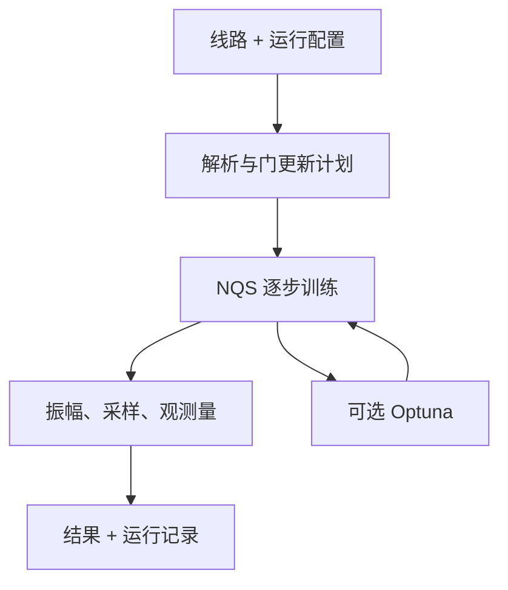

# NQS 量子线路模拟器：初版架构

> 讨论稿，2026-11-02。基于已制定的《神经态库论文复现_方法与代码实现方案》，用于确定复现代码如何扩展为可调用的模拟器；本文不表示这些功能已经实现。

## 1. 目标与边界

输入一条**无噪声量子线路**及训练配置，以自回归 Transformer NQS 近似线路演化后的纯态，返回采样 counts、指定 bitstring 的复振幅，以及用户指定观测量的期望值。第一版采用 Python + PyTorch，单机单 GPU，以可验证的原型为目标。

线路是唯一必需的物理输入。Hamiltonian **不是**演化的必需输入；若用户要计算能量，则需把它作为观测量提交，例如 Pauli 项之和

\[
H=\sum_k c_k P_k,\qquad E=\langle H\rangle=\sum_k c_k\langle P_k\rangle.
\]

调用方负责生成线路及确定门参数；模拟器负责执行给定线路并计算请求的结果。第一版聚焦无噪声纯态线路模拟，噪声和云端接入留待后续。

## 2. 功能

| 功能 | 初版约定 |
|---|---|
| 线路输入 | Python 结构化门列表，含比特数、初态、门顺序及旋转角度；先覆盖复现线路中的门，再补充常见的单、双比特门和参数化旋转门。输入适配器可在后续增加 QASM/Qiskit。 |
| 状态表示 | 复振幅 \(\psi_\theta(x)\) 的自回归 Transformer；直接查询 \(\psi_\theta(x)\) 和从 \(|\psi_\theta|^2\) 采样。 |
| 逐步演化 | 上一步 NQS 冻结为教师；按已复算方案处理对角门层和非对角局域门，训练下一状态。复用同一计算内核。 |
| 结果 | `counts`、指定 bitstring 的振幅、运行耗时和逐步训练摘要。指定观测量时计算期望值及采样统计误差；先支持 Z 类与少量 X/Pauli string，随后扩展 Pauli sum。 |
| 自动调参 | 可选 Optuna，先调少数**全局**训练超参数；固定配置与调参候选均调用相同模拟流程。用户可限制 trial 数或时间。 |
| 运行记录 | 一次任务保存全局线路/网络/训练配置、必要的中途配置变更、结果摘要、状态和调参历史；默认不保存网络权重。 |
| 独立评估 | 小规模与精确模拟比较最终态保真度及观测量；大规模无可靠参考时，训练 loss 仅作为诊断量，不报告为真实保真度。 |

采样估计 Pauli 期望值时，Z 对角项可以直接从 bitstring 计算；X 等非对角项由 NQS 的振幅比构造局域估计量，再对样本平均。因此一般的能量计算不能只靠 Z 基 counts。

## 3. 一次运行的数据流



1. 校验比特编号、门类型、门参数和初态，生成按执行顺序排列的更新计划。
2. 初始化 NQS；对每个更新步骤冻结旧模型、训练新模型，并记录该步的 loss、训练时间及实际配置。相容的对角门可合并为一次更新，非对角局域门先逐个处理。
3. 在最终 NQS 上查询振幅、采样并估计请求的观测量；可用时另做精确对照。
4. 返回结果，写入本次任务摘要。运行中仅保留当前更新所需模型；任务结束默认不存权重。选择保存量子态时才另存模型文件。

## 4. 建议的代码结构

```text
nqs_simulator/
├── config.py          # 全局训练与运行设置
├── circuits.py        # 门描述、合法性检查、更新计划
├── model.py           # Transformer、log ψ、祖先采样
├── losses.py          # 对角/局域门更新目标和损失
├── engine.py          # 冻结教师、逐步训练、统一运行入口
├── observables.py     # Pauli 期望值与统计误差
├── tuning.py          # 可选 Optuna 调参，调用 engine
├── records.py         # 配置、变更、结果与状态记录
├── evaluate.py        # 小规模精确参考与独立评估
└── cli.py             # 简单命令行入口
```

先从既有复现代码的 `model.py`、`losses.py`、`circuits.py` 和训练循环提取计算内核，再增加入口和结果接口；目录名是职责示意，可随复现代码实际组织作小幅调整。建议核心调用关系：

```python
result = simulate(
    circuit,                    # 必需：有具体角度的门序列
    config=training_config,     # 可使用默认设置
    observables=pauli_terms,    # 可选：如 Z_i、X_i 或 Pauli 项之和
    shots=10_000,
    tune=False,                 # 可选启动 Optuna
)
# result: counts、requested_amplitudes、expectations、metrics、run_id
```

`simulate` 接收用户设置或调参选出的设置，始终调用 `engine.py` 中同一套逐步训练流程。若要计算大量指定构型的振幅，使用批量查询接口；不在一次调用中生成完整的 \(2^N\) 态矢量。

## 5. 记录和交付顺序

第一版用 SQLite 或每次任务一份结构化文件即可。记录线路及角度、网络结构、学习率/batch size/训练步数/随机种子、中途改动的位置与新值、最终指标、耗时、软件版本和成功/失败状态。Optuna 的 trial 只保存配置、分数与耗时。**不默认保存 checkpoint 权重**；此前复现方案要求逐步保存 checkpoint，是为了论文复现与断点检查，模拟器的默认持久化策略以本节为准。

建议顺序：①复现代码贯通和数学检查；②固定配置的线路调用、采样与观测量；③运行记录及独立精度评估；④可选 Optuna 自动调参；⑤扩展门集合和线路规模。每一步先用小规模精确参考验证，再逐步扩大尺寸，并记录训练总时间、观测量误差和峰值显存。比较 MPS 时在相同精度或相同计算预算下比较，计入 NQS 全部训练成本。

## 参考

- T. Wang and L. Fu, [*Simulating quantum circuits with a neural statebank*](https://arxiv.org/abs/2606.08707), arXiv:2606.08707 (2026)：逐步局域门更新、自回归网络表示与采样的研究依据。具体 loss、网络参数和复现检查见现有《神经态库论文复现_方法与代码实现方案》。
