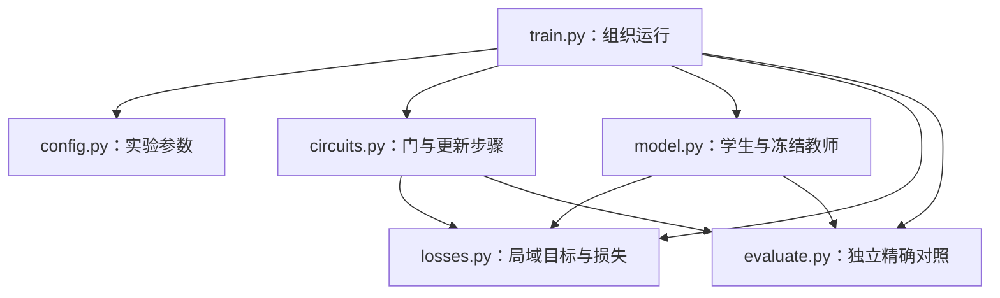

# 基于自回归 Transformer 神经态库的量子线路模拟：方法与代码实现方案

> 本文件整合方法说明与代码开发约定，可直接交给 Codex 生成代码。正文按学术论文的方法部分组织，附录规定最小代码结构、验证和交付要求。全文描述待实现方案，不代表代码已经完成或实验已经成功。
>
> 实施时以本文件为统一入口。原《神经态库论文复现_Codex开发说明.md》保留作讨论记录，不必同时作为另一份开发指令输入。论文明确设置、本次实现选择与待核对事项分别标注，避免混用。

## 摘要

量子线路的经典模拟需要描述随量子门作用而变化的多体波函数，其完整态矢量的存储规模随量子比特数指数增长。本项目拟复现 Wang 和 Fu 提出的神经态库（neural statebank）方法，以自回归 Transformer 表示复波函数，并通过逐步学习量子门作用后的目标态实现近似演化。每一步将上一网络冻结为教师模型，利用量子门的局域作用计算训练目标，再优化新的网络参数。自回归分解支持指定配置的振幅查询及 Born 分布的直接采样。首阶段针对小规模 HCZCH 线路，以精确态矢量演化为参考，考察单步更新误差、累计误差、采样分布和观测量。项目采用简洁的 Python/PyTorch 单机实现，服务于个人科研复现及后续实验分析。

**关键词：** 神经网络量子态；自回归 Transformer；量子线路模拟；局域门更新；直接采样

## 1．研究目标与方法概述

对于 N 个量子比特，计算基配置记为 x=(x₀,…,xₙ₋₁)，各分量取 0 或 1。量子态在计算基下表示为

\[
|\psi_\ell\rangle=\sum_{x\in\{0,1\}^N}\psi_\ell(x)|x\rangle,
\qquad |\psi_\ell\rangle=U_\ell|\psi_{\ell-1}\rangle.
\]

神经态库保存一系列网络参数 θ₀、θ₁、…，用各个 checkpoint 近似表示演化过程中的量子态。第 ℓ 个训练步骤的教师目标为

\[
\widetilde\psi_\ell(x)=\langle x|U_\ell|\psi_{\theta_{\ell-1}}\rangle.
\]

教师网络在当前步骤内冻结。学生从教师参数开始，通过最小化门更新损失逼近目标。目标由上一网络与已知量子门计算，而不是由精确模拟器生成训练标签。精确态矢量仅用于独立评估，也不用于 checkpoint 选择或学习率调度。

程序整体输入包括线路定义、网络结构和训练参数；输出包括逐步训练的网络、日志、精度指标与曲线。训练完成后，网络可独立用于振幅查询、采样和观测量估计。实现不假设不同线路共享一个无需重新训练的通用网络。

首阶段完成 N=8 的 HCZCH 完整流程，再扩展至 N=12、16。小规模实现验证通过后，再考虑原论文较大规模实验及与用户已有 MPS 后端的比较。真机、量子态层析、噪声、多卡、云平台和 SDK 接口不在本阶段范围内。

本方案依据文献[1]的方法部分，核对版本为其 `v1` HTML 页面。编码时记录实际使用的论文版本与下载日期；若找到作者代码，应记录提交版本，并明确与本方案的差异。

## 2．复波函数表示与神经网络

### 2.1 自回归参数化

Born 概率使用条件概率的乘积表示，相位使用逐位置增量之和表示：

\[
\psi_\theta(x)=\exp\left[\frac12\sum_{i=0}^{N-1}\log p_\theta(x_i|x_{<i})+i\sum_{i=0}^{N-1}\phi_{\theta,i}(x_i|x_{<i})\right].
\]

由此有

\[
P_\theta(x)=|\psi_\theta(x)|^2=\prod_i p_\theta(x_i|x_{<i}),
\qquad \sum_x P_\theta(x)=1.
\]

每个位置的条件概率由 softmax 归一化，因此整体概率无需额外计算配分函数。定义实值对数振幅 Aθ 与未缠绕相位 Φθ：

\[
A_\theta(x)=\frac12\sum_i\log p_\theta(x_i|x_{<i}),
\qquad \Phi_\theta(x)=\sum_i\phi_{\theta,i}(x_i|x_{<i}),
\qquad \log\psi_\theta=A_\theta+i\Phi_\theta.
\]

实现需同时保留 Aθ、Φθ。对角更新使用未缠绕相位，不能通过对复数 ψ 取 `angle` 来替代。局域门的振幅干涉则使用复振幅或数学等价的稳定计算。

### 2.2 因果 Transformer 结构

对完整配置 x，输入 token 序列为 `[START, x0, ..., x(N-2)]`，token 嵌入与可学习的位置嵌入相加后进入因果 Transformer。第 i 个位置允许读取当前位置的右移 token 与此前位置，禁止读取未来 token。这样第 i 个位置的预测仅依赖 x₍<ᵢ₎。

设 batch 大小为 B，主干中间特征形状为 B×N×d_model。最终输出每个位置的两个概率 logits 和两个相位增量，其合并输出形状为 B×N×4。选择输入配置实际取值对应的概率和相位，再沿比特维求和，得到每条配置的 Aθ 与 Φθ。

| 项目 | 设置 | 来源 |
|---|---:|---|
| 隐藏维度 d_model | 128 | 论文明确给出 |
| Transformer block 数 | 2 | 论文明确给出 |
| 注意力头数 | 4 | 论文明确给出 |
| 前馈层维度 d_ff | 256 | 论文明确给出 |
| dropout | 0 | 论文明确给出 |
| 位置表示 | 可学习嵌入 | 论文明确给出 |

论文报告 N=22、34 时的参数量分别为 268,932 和 270,468，可作为结构检查参考。具体激活函数、LayerNorm 顺序、末端归一化等尚待与作者实现核对；本项目采用第2.4节明确的起步架构，并将这些细节标为实现选择。参数量相同不能证明网络计算过程完全相同。

### 2.3 输入输出与初始状态

网络接收 B×N 的整数比特张量，返回 B 个复数 log ψ，或分别返回 B 个 Aθ 与 Φθ。这里网络计算的是指定配置的振幅，不是一次输出全部 2ᴺ 个振幅。采样接口接收样本数 M，返回 M×N 的比特张量。

线路开头的全体 H 门将 |0⟩⊗ᴺ 变为 |+⟩⊗ᴺ。将最终输出层的权重和偏置置零即可精确表示该态：所有条件概率均为 1/2，所有相位增量均为零。主干参数采用正常初始化，不全部置零。初始全体 H 不再训练；如后续扩展线路中出现中途 H，则必须执行实际更新。

### 2.4 可直接实现的网络架构

为使代码生成具有确定的网络定义，首版采用以下具体连接。尚未从作者代码确认的部分，包括 GELU、Pre-LayerNorm、末端 LayerNorm 和 bias 设置，均属于本次实现选择；找到作者实现后应单独核对。

| 顺序 | 运算 | 输入与输出尺寸 | 具体约定 |
|---|---|---|---|
| 1 | 输入与右移 | B×N → B×N | 输入为整数0/1；token0=0、token1=1、START=2；不设 padding token |
| 2 | token embedding | B×N → B×N×128 | 三种 token，各128维 |
| 3 | 加位置 embedding | B×N×128 → B×N×128 | N×128可学习参数，不额外乘 √128 |
| 4 | Transformer block 1 | B×N×128 → B×N×128 | 4头因果注意力，每头32维；前馈128→256→128 |
| 5 | Transformer block 2 | B×N×128 → B×N×128 | 同结构、独立参数，无跨 block 权重共享 |
| 6 | 末端 LayerNorm | B×N×128 → B×N×128 | 带可学习缩放与平移 |
| 7 | 线性输出层 | B×N×128 → B×N×4 | 两个概率 logits、两个实值相位增量，含 bias |
| 8 | 选择与求和 | B×N×4 → 两个 B 维实数 | logits 经 log_softmax；按实际比特选择，得到 Aθ、Φθ |

每个 block 使用 Pre-LayerNorm 与两次残差连接。若输入特征为 z，则

\[
z'=z+\operatorname{MHA}_{\mathrm{causal}}(\operatorname{LN}_1(z)),
\qquad
z''=z'+W_2\operatorname{GELU}(W_1\operatorname{LN}_2(z')+b_1)+b_2.
\]

注意力的 Q、K、V 和输出投影均含 bias；两层前馈均含 bias；每个 LayerNorm 作用于最后的128维，ε=1e-5，均带可学习缩放与平移。所有 dropout 为0。因果遮罩禁止注意力读取右移 token 序列中列索引大于当前行索引的位置。相位输出使用无界实数，不附加 softmax、tanh 或逐位置 wrap。

主干及嵌入采用正常随机初始化，两个 block 应具有独立随机初值，最终线性输出层权重与偏置置零。此结构与第2.1节共同定义波函数，不另设第二个相位 Transformer。

按上述结构的线性层、嵌入与归一化参数直接计数，得到

\[
N_{\mathrm{parameters}}=266116+128N.
\]

其中 token embedding 为384个参数，每个 block 为132480个，末端 LayerNorm 为256个，输出层为516个，位置 embedding 为128N个。因此 N=8、16、22、34 时分别为267140、268164、268932、270468个参数。后两项与论文报告值一致，但激活与残差顺序的来源状态仍为实现选择。编码后打印实际参数量检查，不用该计数代替数值验证。

## 3．局域门作用与训练损失

### 3.1 对角门层

对角门层满足 U|x⟩=exp(iΦU(x))|x⟩，其 Born 概率不变。以 old 标记冻结网络，定义

\[
\Delta(x)=\Phi_\theta(x)-\Phi_{\mathrm{old}}(x)-\Phi_U(x),
\qquad \delta(x)=\Delta(x)-\mathbb E_\rho[\Delta(x)].
\]

减去平均残差用于消除不可观测的全局相位。按文献[1]式(10)–(12)，采用

\[
\mathcal L_{\mathrm{diag}}=\mathbb E_{x\sim\rho}\left[(A_\theta(x)-A_{\mathrm{old}}(x))^2+4\delta(x)^2\right].
\]

振幅项要求保持旧概率分布，相位项要求学习门引入的相位变化。Tᵢ 的相位为 πxᵢ/4，CZᵢⱼ 的相位为 πxᵢxⱼ；一个对角训练步骤内的相位贡献直接相加。训练中用 minibatch 均值估计期望，不能在该损失中擅自将残差改为逐样本 wrap 或 circular loss。

### 3.2 非对角局域门

设 S 为活动比特集合，α、β 为活动配置，y 为其余比特（spectator）配置。固定 y 后，枚举全部活动配置并计算

\[
t_{y\alpha}=\sum_\beta u_{\alpha\beta}\psi_{\mathrm{old}}(y,\beta),
\qquad s_{y\alpha}=\psi_\theta(y,\alpha).
\]

单比特门枚举 2 项，双比特门枚举 4 项；无需构造全系统态矢量。为约束复振幅的不同组成，定义局域概率质量与归一化概率：

\[
M_y^*=\sum_\alpha|t_{y\alpha}|^2,\qquad M_y^\theta=\sum_\alpha|s_{y\alpha}|^2,
\]

\[
p_y^*(\alpha)=\frac{|t_{y\alpha}|^2}{M_y^*},\qquad
q_y^\theta(\alpha)=\frac{|s_{y\alpha}|^2}{M_y^\theta}.
\]

这里的概率是在固定全部 spectator 后归一化得到的块内概率，一般不等于自回归网络只给定前缀时的某个单点条件概率。

相位项和局域重叠定义为

\[
\mathcal L_\phi(y)=\sum_\alpha p_y^*(\alpha)\left[1-\cos(\arg s_{y\alpha}-\arg t_{y\alpha})\right],
\]

\[
O_y^2=\frac{\left|\sum_\alpha t_{y\alpha}^*s_{y\alpha}\right|^2}{M_y^*M_y^\theta}.
\]

按文献[1]式(13)–(18)，采用

\[
\mathcal L_{\mathrm{local}}=\mathbb E_y\left[
4\,\mathrm{KL}(p_y^*\|q_y^\theta)+4\mathcal L_\phi(y)
+4(\log M_y^\theta-\log M_y^*)^2+(1-O_y^2)\right].
\]

四项分别约束块内概率分配、相位、不同 spectator 配置的概率质量以及局域复向量重叠。仅拟合归一化条件分布会遗漏不同 y 之间的权重；仅使用局域重叠又无法约束各 y 之间的相对相位。因此应保留全部四项，并分别输出其数值。

例如 H 作用于某一比特时，对于每个固定 y，目标为

\[
t_{y0}=\frac{\psi_{\mathrm{old}}(y,0)+\psi_{\mathrm{old}}(y,1)}{\sqrt2},
\qquad
t_{y1}=\frac{\psi_{\mathrm{old}}(y,0)-\psi_{\mathrm{old}}(y,1)}{\sqrt2}.
\]

这直接体现非对角门如何通过振幅相加与相减引入干涉。CH 则在控制位为 1 的子空间应用上述变换，在控制位为 0 的子空间保持不变。HCZCH 首阶段主要训练双比特 CH、CNOT；H 的单比特实现用于数学检查及后续扩展。

### 3.3 数值实现约定

教师计算与采样不保留梯度，学生振幅计算保留梯度。零目标概率的 KL 项按极限值 0 处理；目标零振幅的相位项权重为零，应屏蔽其未定义相位。实现使用 logsumexp 或适当的共同缩放避免下溢，概率质量损失必须保留缩放前的实际质量。

不能分别消除每个 y 的相位偏移，因为这会去除不同 spectator 配置之间应当学习的相对相位。不要将论文目标替换成任意振幅均方误差，也不要将 CNOT 改为另一种全局回归算法后仍称为同一复现设置。

## 4．采样方法与优化过程

### 4.1 自回归祖先采样

完整配置逐比特生成：

\[
x_0\sim p_\theta(x_0),\qquad
x_i\sim p_\theta(x_i|x_{<i}),\quad i=1,\ldots,N-1.
\]

例如首先生成 x₀=1，则下一位从 pθ(x₁|1) 抽取；若得到 x₁=0，则随后使用 pθ(x₂|1,0)。每个位置根据当前已生成的前缀重新计算条件分布，直至得到完整样本。不同样本使用独立随机抽取，重复 bitstring 合法。该过程无须 Metropolis 接受拒绝、热化或链间隔。

首版可按位置循环并重新前向计算，不实现 KV cache。模型在固定参数下的归一化和采样正确性，与该模型对真实量子态的近似精度是不同问题，需要分别验证。

### 4.2 训练分布与 spectator 采样

对角训练采用文献[1]的混合分布形式

\[
\rho(x)=(1-\eta)P_{\mathrm{old}}(x)+\eta\,2^{-N}.
\]

每条样本独立选择旧网络祖先采样或均匀随机 bitstring。均匀分量提供对其他配置的覆盖。直接从 ρ 抽取后，损失采用普通样本平均，不再乘一次 Pold 权重。

非对角更新在本次起步实现中采用同样的完整配置混合采样，再删除活动比特，得到 y，并枚举 α。其 spectator 分布明确为

\[
\rho_S(y)=(1-\eta)\sum_\alpha P_{\mathrm{old}}(y,\alpha)+\eta\,2^{-(N-|S|)}.
\]

这一具体 spectator 采样方案属于本次实现选择，仍需与作者代码对齐。第一版不对重复 y 去重；若以后去重，必须保留频次权重，否则会改变训练分布。

### 4.3 优化与 checkpoint

每个训练步骤先复制当前模型得到冻结教师，学生继承相同初值。拟采用 Adam 优化 minibatch 损失，每次迭代重新抽样，使用固定学习率与梯度范数裁剪。新门更新开始时重新建立 optimizer，保留网络参数，重置 optimizer 的动量状态。这一重置规则是实现选择，原作者设置待核对。

每步固定训练预算，保存训练结束的学生作为下一教师；精确保真度不参与选择。初始化状态及各步模型均保存 checkpoint，包含网络配置、参数、训练步骤和对应门位置，使其可独立加载进行振幅查询和采样。

## 5．观测量与 local energy 类似量

对于算符 O，采用局域估计量

\[
O_{\mathrm{loc}}(x)=\frac{\langle x|O|\psi_\theta\rangle}{\psi_\theta(x)}
=\sum_{x'}O_{xx'}\exp[\log\psi_\theta(x')-\log\psi_\theta(x)].
\]

由 Born 分布采样后，估计量为

\[
\langle O\rangle=\mathbb E_{x\sim P_\theta}[O_{\mathrm{loc}}(x)]
\approx\frac1M\sum_{m=1}^M O_{\mathrm{loc}}(x^{(m)}).
\]

当 O=H 时即为 local energy，但本项目的主训练目标是门更新损失，而不是能量最小化。对于稀疏算符，只需查询少数相连配置的振幅。首阶段实现 Z₀、X₀、Z₀Zₕ，其局域估计量分别为

\[
(Z_0)_{\mathrm{loc}}(x)=(-1)^{x_0},\qquad
(X_0)_{\mathrm{loc}}(x)=\frac{\psi_\theta(x^{\mathrm{flip}\,0})}{\psi_\theta(x)},\qquad
(Z_0Z_h)_{\mathrm{loc}}(x)=(-1)^{x_0+x_h}.
\]

观测量样本来自学生 Pθ，而非直接对混合训练分布做无权平均。记录样本均值与统计误差；有限样本下非对角局域估计量均值可能有虚部，应记录以便检查，不能逐样本取绝对值后代替原估计量。一般 Hamiltonian 接口可留待后续，不增加首版封装。

## 6．HCZCH 线路与参数设置

### 6.1 门连接与物理线路

采用偶数 N，令 h=N/2。对 G 为 CZ、CH 或 CNOT，定义

\[
G_o=\left\{G\left(q_a,q_{h+((a+o)\bmod h)}\right):a=0,\ldots,h-1\right\}.
\]

主线路按时间顺序执行

\[
H_{\mathrm{all}}\rightarrow\mathrm{CZ}_4\rightarrow T_{\mathrm{all}}
\rightarrow\mathrm{CH}_5\rightarrow T_{\mathrm{all}}\rightarrow\mathrm{CNOT}_7.
\]

下标 4、5、7 是连接偏移，不是重复次数。CH、CNOT 的第一个比特是控制位。双比特矩阵基顺序固定为 |00⟩、|01⟩、|10⟩、|11⟩。T=diag(1,exp(iπ/4))，CH=|0⟩⟨0|⊗I+|1⟩⟨1|⊗H。以上主线路与定义依据文献[1]式(19)–(20)。

本实现约定 q₀ 为自写态矢量索引的最高位。精确演化采用局域张量操作，不建立 2ᴺ×2ᴺ 的全系统门矩阵。与外部软件比较时显式转换端序。

### 6.2 物理层与训练步骤

首版调度如下，属于本次实现选择：

| 物理操作 | 学习安排 | 训练步骤数 |
|---|---|---:|
| 初始全体 H | 精确初始化 | 0 |
| CZ₄ 门层 | 整层一次对角更新 | 1 |
| 第一层全体 T | 一次对角更新 | 1 |
| CH₅ 门层 | 按 a 升序逐个双比特更新 | h |
| 第二层全体 T | 一次对角更新 | 1 |
| CNOT₇ 门层 | 按 a 升序逐个双比特更新 | h |

总计 N+3 次训练更新。记录物理层编号、门编号和训练步骤编号。不能将整层 h 个非对角门当作只有 4 个活动配置的单门更新。N=8 时偏移取模会使部分连接结构重合，因此其主要用途是程序贯通；随后以 N=12、16 检查更丰富的连接和学习行为。

### 6.3 起步超参数

| 配置项 | 起步设置 | 来源或状态 |
|---|---:|---|
| n_qubits | 8，随后 12、16 | 本项目验证方案 |
| d_model / n_layers / n_heads / d_ff | 128 / 2 / 4 / 256 | 论文明确给出 |
| dropout | 0 | 论文明确给出 |
| optimizer | Adam | 实现选择，作者设置待核对 |
| learning_rate | 1e-3 | 建议起步值 |
| Adam β₁ / β₂ / ε | 0.9 / 0.999 / 1e-8 | 实现选择 |
| weight_decay | 0 | 实现选择 |
| batch_size | 256 | 建议值；完整配置或 spectator 的条数 |
| train_steps_per_update | 1000 | 建议值；短流程可改为 20 |
| uniform_mix_eta | 0.1 | 建议值；论文的具体调度待核对 |
| gradient_clip_norm | 1.0 | 建议值，记录裁剪前范数 |
| 学习率调度 | 无 | 实现选择 |
| optimizer 状态 | 每次门更新重置 | 实现选择 |
| seed | 42，后续 42、43、44 | 本项目设置 |
| device | CUDA 可用时 cuda，否则 cpu | 运行时检测 |
| 训练精度 | float32 / complex64 | 起步设置 |
| 精确参考精度 | complex128 | 小规模验证设置 |
| 默认精确参考规模上限 | N≤16 | 本实现资源约束 |
| 采样检查及观测量样本数 | 10000 | 建议起步值 |

这些设置不保证达到论文精度。实际运行应保存所有覆盖后的配置、软件版本和设备，不把建议值写成论文原始超参数。

## 7．验证、误差与计算成本

对归一化状态，区分单步门更新误差和累计误差：

\[
\epsilon_{\mathrm{step}}^{(\ell)}=1-\left|\langle\psi_{\theta_\ell}|U_\ell|\psi_{\theta_{\ell-1}}\rangle\right|^2,
\]

\[
\epsilon_{\mathrm{total}}^{(\ell)}=1-\left|\langle\psi_{\theta_\ell}|\psi_\ell^{\mathrm{exact}}\rangle\right|^2.
\]

前者考察当前目标是否学好，后者考察与真实线路轨迹的偏差。小规模通过分批枚举振幅求和计算，并在逐门训练的每个步骤同步推进精确参考。采样分布另以经验频率与网络枚举概率比较，不能仅依赖保真度判断采样器正确。

训练时间、独立评估时间、训练后的振幅查询及采样时间分别记录。GPU 计时进行同步，显存报告 peak allocated；查询时间明确 batch 大小。大规模缺少可靠参考时，真实保真度标为未评估，不能用训练 loss 或局域重叠代替。

可将最终 infidelity≤1e-2 作为起步调参目标，但这是本项目目标，不是已通过的结果。检查失败时先排查位序、目标构造、损失及采样；随后再分析优化与表达能力，不预先认定某一种原因。

## 8．适用范围、待核对事项与后续研究

首阶段的完成标志是可重复运行的小规模完整流程，以及真实记录的数学检查和数值结果。它不等于已经复现大规模速度或存储优势。后续比较 MPS 时，应以相同精度下的总成本或相同预算下的精度为依据，计入 NQS 训练成本，并扫描 MPS bond dimension。

待核对项包括作者代码可用性、论文固定版本、激活与归一化细节、优化器及学习率、每步训练预算、混合比例调度、spectator 抽样规则、门层拆分和 optimizer 状态处理。未核实前按本文件的明确起步选择实现，并在运行记录中标注。发现作者设置不同时，保留原试验配置，再单独运行对齐设置，不混合比较。

## 参考文献

[1] T. Wang and L. Fu, *Simulating quantum circuits with a neural statebank*, arXiv:2606.08707. [摘要页面](https://arxiv.org/abs/2606.08707)；[本次核对的 v1 方法正文](https://arxiv.org/html/2606.08707v1)。波函数与结构见 Representation；目标见 Training objectives，式(8)–(18)；HCZCH 见 Circuit definitions，式(19)–(20)；保真度见 Benchmarks and fidelity。

---

## 附录 A．Codex 代码实现约定

### A.1 工作目录与代码范围

目标目录为 `D:\OneDrive\NQS\nqs_neural_statebank_reproduction`。请先在 Codex 中将该目录打开为工作目录，确认权限和已有文件后再生成代码；无法写入时如实报告。保留用户已有代码，不覆盖未知文件。

使用 Python + PyTorch，单机单 GPU，CPU 可用于短流程调试。代码以便于阅读和修改为准，参数放在一个 Python 配置中。不增加前端、平台接口、SDK、插件、通用算子框架或多卡抽象；不引入 RBM、SR、p-tVMC 或 Walsh 扩展。

### A.2 最小代码结构与公式对应

| 文件 | 功能与正文对应 |
|---|---|
| `config.py` | 第6节全部配置与实际覆盖值 |
| `model.py` | 第2节网络、Aθ、Φθ、log ψ；第4节祖先采样 |
| `circuits.py` | 第6节门矩阵、连接、物理层与训练调度 |
| `losses.py` | 第3节教师目标与两类损失，各分量可单独记录 |
| `train.py` | 第1、4节冻结教师、优化循环、保存及评估调用 |
| `evaluate.py` | 第5、7节精确演化、观测量、误差与基础画图 |
| `checks.py`（如有必要） | 附录B的少量数学与流程检查 |
| `README.md` | 安装、运行命令、端序约定、参数来源、实际完成范围 |
| `requirements.txt` | 最小依赖及实际验证过的版本信息 |
| `results/` | 各次实验独立目录 |

默认依赖为 PyTorch、NumPy、Matplotlib。不强制安装 Qiskit、quimb 或 MPS 后端。函数命名清楚、注释解释关键数学，不建立多层包或配置系统。

核心接口建议如下，可为清晰性作小幅调整：

```python
log_amplitude, phase = model.log_amplitude_phase(bits)  # 各 [batch] 实数
log_psi = model.log_psi(bits)                          # [batch] 复数
samples = model.sample(n_samples)                     # [n_samples, n_qubits]
```

说明每个张量的形状、活动比特次序与门矩阵约定。没有完整态矢量依赖的训练路径，不能在训练中偷偷枚举全系统目标。

### A.3 每次运行的保存内容

| 输出 | 内容 |
|---|---|
| `config.json` | 完整配置、参数来源、种子、版本、设备、论文版本、实际训练调度 |
| `training.csv` | 迭代、总 loss、所有子项、梯度范数；允许设置日志间隔 |
| `metrics.csv` | 训练步、物理层、门、单步/累计误差、观测量与统计误差、耗时、显存 |
| `step_000.pt` 及后续模型 | 初态及每个训练步骤的网络结构配置、参数、门位置 |
| 曲线文件 | 单步/累计误差与必要 loss 曲线，不生成交互网页 |

未计算的指标写为空值并说明原因，不能伪造。checkpoint 重新加载后的模型必须可以独立完成振幅查询和采样。

## 附录 B．最小验证与开发顺序

只做能够验证数学正确性和完整流程的必要检查：

1. 小规模枚举概率和为1，零输出头初态为 |+⟩⊗ᴺ。
2. 改变当前与未来的目标比特不影响对应位置及先前位置的条件预测，排除自回归泄漏。
3. 使用非均匀条件分布比较祖先采样频率与网络枚举概率，避免仅检查均匀态。
4. H、T、CZ、CNOT、CH 的局域目标与精确作用一致，覆盖非相邻比特和不同控制/目标顺序。
5. 学生等于教师、门为恒等时，两类损失接近0；教师无梯度、学生梯度有限；目标含零振幅时没有 NaN。
6. 完成短流程训练、保存、评估及重新加载；之后运行正常训练并报告实际精度。

浮点数学检查可采用 float32 下1e-6、float64 下1e-10的参考容差，采样误差按统计量评估，不套用浮点容差。网络拟合精度属于实验结果，不能写成硬编码的通过条件。

开发依次完成环境检查、网络与采样、门与精确参考、局域目标与两类 loss、完整训练和结果保存。先做 N=8 每次门更新20步的短流程，再做完整预算；环境无法承担完整训练时，明确已完成的检查和剩余工作，不伪造完成状态。

## 附录 C．交付与可直接使用的 Codex 指令

代码完成后，提交文件与运行命令、已运行检查、真实结果及限制，并指出本方案与实际实现的差异。当前正文是预先的方法方案；后续正式方法文章需依据实际代码和实验修订。先给出修订提纲供用户确认，不自动生成另一份带未经验证结论的正式论文。

可直接向 Codex 发送：

> 请阅读项目目录中的《神经态库论文复现_方法与代码实现方案.md》，按正文数学方法及附录要求生成简洁的 Python/PyTorch 复现代码。按第2.4节实现具体网络，按附录D连接训练、局域目标与独立评估。先检查目录、环境和已有文件，再分步完成小规模 HCZCH 流程并做必要验证。采用六个核心 Python 文件，保持易读，不做生产封装。正文是拟实现方案，建议起步参数和待核对项不能写成论文已确认设置。精确态矢量仅作独立评估，不生成训练标签。完成后报告真实结果、运行命令和方案差异，并给出学术方法文档的修订提纲供我确认。

## 附录 D．程序架构、调用关系与数据流

本附录与第2.4节分别定义程序架构和网络架构。它们是待实现的具体蓝图；最终代码生成后，还需要核对实际函数及数据流是否与之相符。

### D.1 模块边界与依赖

由 `train.py` 组织训练，其他模块保持直接的函数调用。`model.py` 不依赖线路或精确模拟；`circuits.py` 不依赖神经网络；`losses.py` 使用网络和局部门描述；`evaluate.py` 接收模型及独立参考，不将参考返回为训练目标。



精确对照不向 `losses.py` 提供完整态矢量。图中的模型到评估依赖用于查询振幅和观测量，不表示评估值参与反向传播。

### D.2 门描述与局域配置的数据形状

门描述采用简单字典或轻量结构，包含门名、按矩阵顺序排列的 qubits、必要的旋转参数及物理层编号，不引入门类继承体系。对角更新步骤可包含一个门列表；非对角更新步骤只包含一个单比特或双比特门。首版只构造 HCZCH，额外的单比特 H 用于正确性检查。

设局域活动维数 K=2的|S|次方，单比特门 K=2，双比特门 K=4。数据流约定如下：

| 张量 | 尺寸 | 内容 |
|---|---|---|
| 完整训练配置 | B×N | 由旧网络与均匀分布混合采样 |
| spectator配置 | B×(N−|S|) | 删除活动比特，保持其余比特原有次序 |
| 枚举配置 | B×K×N | 固定每个y并依次填入所有活动配置 |
| 网络查询输入 | (B·K)×N | 将枚举配置展平后批量计算 |
| 教师、学生振幅 | B×K | 返回后恢复局域块维度 |
| 局部门矩阵u | K×K | 行为输出α，列为输入β |
| 目标振幅t | B×K | t[b,α]=Σβ u[α,β]·ψold[b,β] |
| 块内概率p、q | B×K | 分别沿K维归一化 |
| 概率质量M | B | 沿K维累加振幅模平方 |
| 总loss | 标量实数 | 每个y算完各子项后沿B维平均 |

活动配置的位序跟随门描述的 qubits 列表。双比特取值依次为00、01、10、11；若 qubits 为(control,target)，第一位就是控制位，不因物理索引大小而重排。共同缩放和零振幅处理遵循第3.3节。

### D.3 训练运行顺序与梯度边界

1. 读取配置并设定随机种子，构造 HCZCH 门列表和更新日程；初始化学生为精确 |+⟩⊗ᴺ，保存初态 checkpoint。仅在允许的小规模评估模式下建立独立参考态。
2. 当前更新开始时深复制学生为教师，设置教师参数不求梯度并使用评估模式；两个模型不能共享可被 optimizer 修改的参数存储。
3. 为当前学生创建 Adam。每次迭代在无梯度模式下从教师混合分布采样。对角更新直接计算教师A、Φ及门相位；局域更新在无梯度模式下枚举并计算教师目标t。
4. 用学生计算相同配置的A、Φ或复振幅，建立可微损失；清空学生梯度、反向传播、记录并裁剪梯度、执行 optimizer 更新。教师目标与采样选择均不反向传播。
5. 当前步骤结束后保存学生参数；独立推进精确参考并评估单步误差、累计误差和观测量。评估使用无梯度模式，并单独计时。
6. 结束当前步骤后释放不再使用的教师和 optimizer，再处理下一步骤。历史 checkpoint 放在磁盘，显存中不保留所有历史网络。

第一版用清晰的逐步循环即可，门更新不需要单独的调度器类。训练运行固定参数后，各步骤的网络与optimizer状态处理必须与第4.3节一致。

### D.4 入口与独立评估

`train.py` 的 `main()` 是训练入口，参数首先从 `config.py` 读取。`evaluate.py` 的入口可接收一个结果目录或 checkpoint 路径，恢复网络结构与参数，独立计算所选指标和曲线。除该路径参数外，不要求复杂命令行参数系统。

一个简单的 `make_hczch(n_qubits)` 返回门与更新日程；`diagonal_loss(...)`、`local_loss(...)` 返回标量loss及各分量；`evaluate_step(...)` 接收当前模型、冻结教师、当前门及独立参考并返回评估字典。实现可微调函数签名，但保持数学责任和梯度边界不变。README 中给出实际可运行的训练、短流程检查与重新加载评估命令。
